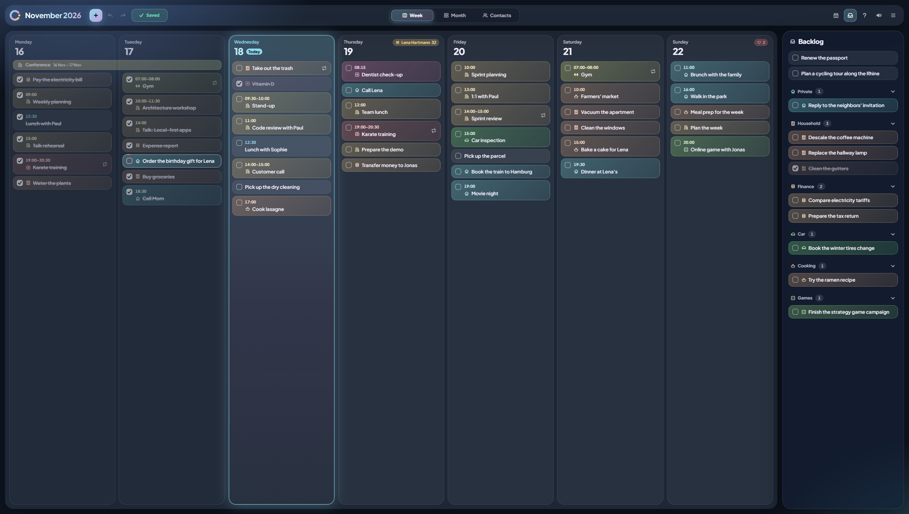
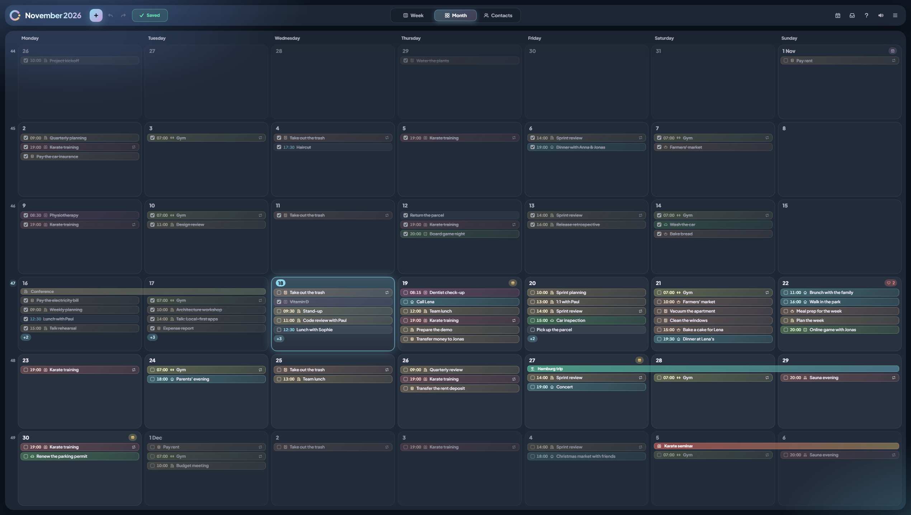
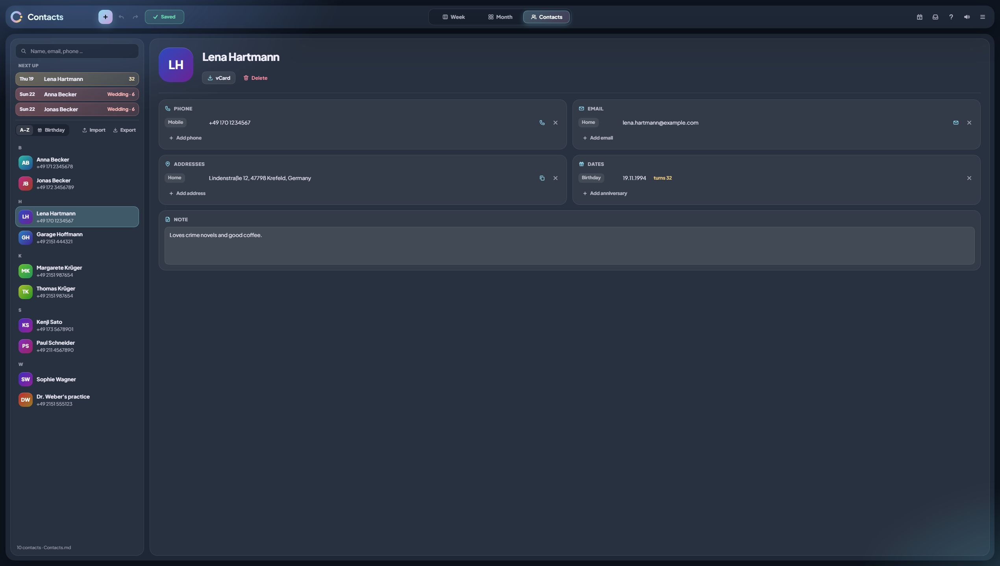

<p align="center"></p>
<h1 align="center">MD_Calendar</h1>
<p align="center">

MD_Calendar is an interactive, fully local Markdown calendar built around ordered to-do lists per day.<br>
Plan your days while keeping your data open, portable, and human-readable.



## Key features

- Week and month views. Optimized for both landscape and portrait monitors.
- Entries with optional time, location, note and tag; multi-day and recurring entries.
- Grouped backlog for entries that are not scheduled yet.
- Contact editor with birthdays and anniversaries.
- Drag and drop, multi-selection, copy and paste, and keyboard controls.
- Undo and redo across everything with calendar-wide fuzzy search.
- ICS import of a calendar history or a single invitation.
- External-change detection, reload or overwrite resolution, and retryable saves.
- Fully local and offline, with no cloud services, installation, or web server.

<table>
  <tr>
    <td width="50%"></td>
    <td width="50%"></td>
  </tr>
  <tr>
    <td align="center">Month view</td>
    <td align="center">Contact editor</td>
  </tr>
</table>

<p align="center"><em>Theme: Nord.</em></p>

## Quick Start

### Launching

From a clone of the repository, run `npm ci` and `npm run build` once; this bundles [MD_Libs](https://github.com/Zang3th/MD_Libs) into `dist/app.js`.

Then open `MD_Calendar.html` in a Chromium-based browser with support for the File System Access API. Choose “New calendar” for a new or existing folder of Markdown files, or “Open folder” for a folder that is already set up.

### Markdown Example

Examples of every file are stored locally in [`data/parsing/`](https://github.com/Zang3th/MD_Calendar/tree/master/data/parsing); they also serve as the golden files for parsing.

### Data

- One folder holds all data, kept in sync by a sync client of your choice.
- Only folders with `MD_Calendar.json` open; “New calendar” on the start page sets a folder up.
- Markdown is the canonical format; parsing creates plain JavaScript state.
- Serialization writes state changes back to the files in the folder.
- Handles of the five most recently opened folders are stored in IndexedDB.
  - Calendar content remains in its Markdown files.

| File | Content | Written |
|:-----|:--------|:--------|
| `Calendar.md` | Entries, multi-day entries, recurring entries | yes |
| `Backlog.md` | Backlog groups and their entries | yes |
| `Contacts.md` | Contacts with birthdays | yes |
| `Holidays.md` | Public holidays and school vacations, generated outside the app | no |
| `Config.md` | Tags with colors and icons, maintained by hand | no |
| `MD_Calendar.json` | Technical data: format version, devices, hashes of saved files; marks the folder as a calendar folder | yes |

The calendar document base structure is:

```text
# Calendar
├── ## November 2026
│   └── ### 18.11.2026
│       └── - [ ] 14:00 - 15:00 Customer call #Work
├── ## Multi-day
│   └── ### Conference #Work
└── ## Recurring
    └── ### Gym #Training
```

Supported metadata:

- `#Start` and `#End` define the range of a multi-day entry.
- `#Start` and `#Repeat` define a recurring entry; `#Repeat` holds an RFC 5545 `RRULE` (daily, weekly, monthly by day or position, yearly).
- `#Except` and `#Done` list skipped and finished occurrences of a recurring entry.
- `#Location` and `#Note` add details to multi-day and recurring entries.
- A trailing `#Tag` on an entry line or heading assigns one of the tags from `Config.md`.

## Technical implementation

MD_Calendar uses a layered architecture built around Markdown as the data source. Pure domain operations manage entries, recurrence, the backlog and contacts independently of the DOM, the I/O layer handles parsing, ICS and vCard conversion and local file access, and the UI layer renders state and delegates persistent changes back to the domain. `app.js` connects these layers and coordinates the application lifecycle, keeping business rules, persistence, and presentation independently testable.

Undo and redo, saving, file conflicts, notifications and the build come from the shared application core [MD_Libs](https://github.com/Zang3th/MD_Libs).

### Project structure

```text
MD_Calendar/
├── data/
│   └── parsing/             # Golden files that define the data format
├── docs/                    # Product, domain, architecture and UI specification
├── domain/                  # Pure business rules and state transitions
├── io/                      # Markdown, ICS, vCard and local file access
├── res/
│   ├── icons/               # Standalone SVG files of the UI icons
│   ├── logo/                # Application logo and web icon set
│   ├── screenshots/         # README screenshots
│   └── tag-icons/           # Standalone SVG files of the tag icons
├── tests/
│   ├── e2e/                 # Playwright interaction and layout tests
│   └── unit/                # DOM-independent Node.js tests
├── tools/                   # Build, architecture and statistics checks
├── types/                   # Global JSDoc type declarations
├── ui/                      # Rendering, layout, and interactions
├── vendor/                  # Local interface font
├── dist/                    # Generated bundle (npm run build), not committed
├── app.js                   # Bundle entry, application wiring and lifecycle
├── MD_Calendar.html         # Entry point
└── styles.css               # Styles and theme tokens
```

### Testing and verification

Node.js and npm are required for development checks:

```bash
npm ci
npm run verify
```

The verification pipeline builds the bundle and runs strict TypeScript checking for JavaScript with JSDoc, ESLint with zero warnings, architecture-boundary checks, unit tests, and Playwright tests in Chromium.

### Releases

<table>
  <thead>
    <tr>
      <th rowspan="2">Release</th>
      <th rowspan="2">Date</th>
      <th colspan="3">Lines of code</th>
      <th rowspan="2">Tests</th>
      <th rowspan="2">Main features</th>
    </tr>
    <tr>
      <th>HTML</th>
      <th>CSS</th>
      <th>JS</th>
    </tr>
  </thead>
  <tbody>
    <tr><td>master</td><td>22.11.2026</td><td>599</td><td>805</td><td>5,472</td><td>86</td><td>See <a href="https://github.com/Zang3th/MD_Calendar/blob/master/docs/Roadmap.md">roadmap</a></td></tr>
    <tr><td>v0.7.0</td><td>19.11.2026</td><td>591</td><td>805</td><td>5,472</td><td>86</td><td>Reworked entry dialog, contacts and start page</td></tr>
    <tr><td>v0.6.0</td><td>16.11.2026</td><td>517</td><td>606</td><td>4,070</td><td>59</td><td>Project baseline with MD_Libs as application core</td></tr>
  </tbody>
</table>

### Vendor

| Component | Version | Functionality | License |
|:----------|:--------|:--------------|:--------|
| [MD_Libs](https://github.com/Zang3th/MD_Libs) | master | Shared application core and build | [MIT](https://github.com/Zang3th/MD_Libs/blob/master/LICENSE) |
| [SortableJS](https://github.com/SortableJS/Sortable) | 1.15.7 | Drag and drop | [MIT](https://github.com/SortableJS/Sortable/blob/master/LICENSE) |
| [Plus Jakarta Sans](https://github.com/tokotype/PlusJakartaSans) | 2.071 | Interface typography | [SIL OFL 1.1](https://github.com/Zang3th/MD_Calendar/blob/master/vendor/fonts/LICENSE) |

## License

MD_Calendar is licensed under the [MIT License](https://github.com/Zang3th/MD_Calendar/blob/master/LICENSE).
